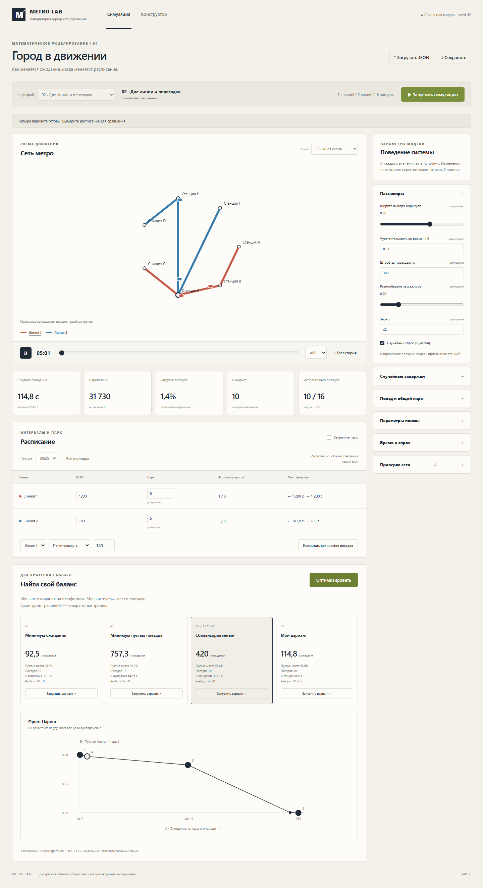
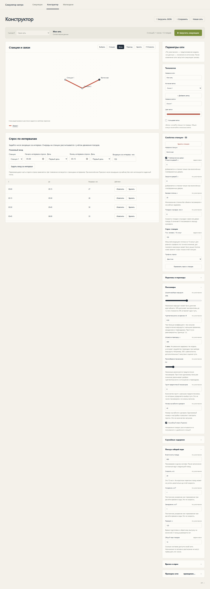

# Metro Lab — симулятор и оптимизатор сети метро

Учебное веб-приложение для экспериментов с поездами и пассажиропотоками. Вы выбираете готовую сеть или собираете свою, задаёте спрос, расписание и парк, рассчитываете сутки, смотрите движение поездов и сравниваете варианты оптимизации.

Есть конструктор, загрузка и сохранение JSON, импорт спроса из CSV, анимация с перемоткой, тепловые карты, редактор расписания, параметры пассажиров и задержек, подбор числа поездов и многокритериальная оптимизация. Для демонстрации на реальных входных потоках подключён участок Лондона с данными TfL NUMBAT.

## Содержание

- [Установка и запуск](#установка-и-запуск)
- [Первый эксперимент за пять минут](#первый-эксперимент-за-пять-минут)
- [Где что находится в интерфейсе](#где-что-находится-в-интерфейсе)
- [Симуляция, карта и показатели](#симуляция-карта-и-показатели)
- [Расписание и парк](#расписание-и-парк)
- [Оптимизация и сравнение](#оптимизация-и-сравнение)
- [Расчёт числа поездов](#расчёт-числа-поездов)
- [Пассажиры, задержки и время](#пассажиры-задержки-и-время)
- [Своя сеть: конструктор](#своя-сеть-конструктор)
- [Файлы, CSV и валидация](#файлы-csv-и-валидация)
- [Лондон и источники данных](#лондон-и-источники-данных)
- [API](#api)
- [Проверки и бенчмарки](#проверки-и-бенчмарки)
- [Решение проблем](#решение-проблем)
- [Модель и структура проекта](#модель-и-структура-проекта)

## Установка и запуск

### Что установить заранее

| Компонент | Требование |
|---|---|
| Python | 3.11+. Проверены Windows/Python 3.13 и Linux/Python 3.11, 3.12. Для первого запуска рекомендуется 3.13. |
| Node.js и npm | Node 20.19+ в ветке 20, 22.12+ в ветке 22 либо Node 24. Проверенная конфигурация — Node 24; npm идёт вместе с ним. |
| Git | Нужен для `git clone`; можно использовать уже скачанную папку. |
| Браузер | Современный браузер с Canvas; автотесты выполняются в Chromium. |
| Интернет | Для первой установки зависимостей. Готовые демо и сохранённые источники Лондона затем доступны без скачивания TfL. |

Docker, база данных, Redis и ключи TfL для обычного запуска не требуются. Активировать Python-среду необязательно: команды явно используют интерпретатор из `.venv`.

### Windows — PowerShell

Если проект уже находится на этом компьютере:

```powershell
cd C:\Prog\Project_Autumn
```

Для новой копии вместо этого выполните:

```powershell
git clone https://github.com/Dzmitry-Leushukou/Project-Autumn.git
cd Project-Autumn
```

Проверьте инструменты и установите зависимости:

```powershell
py -3.13 --version
node --version
npm --version
py -3.13 scripts/setup.py
```

Скрипт создаёт `.venv`, устанавливает точные Python-зависимости из `requirements.lock.txt`, подключает проект в режиме editable и запускает `npm ci` для `web/`. Дождитесь завершения без ошибки. Повторный запуск обновляет установку по lock-файлам.

Запустите всё одной командой:

```powershell
.\.venv\Scripts\python.exe scripts/demo.py
```

Скрипт поднимает backend и frontend, ждёт готовности и открывает браузер. Оставьте терминал открытым. Для остановки нажмите **Ctrl+C** в нём: завершатся оба процесса.

Если установлена другая поддерживаемая версия Python, выберите её в `py`, например `py -3.11 scripts/setup.py`. Можно использовать `python scripts/setup.py`, если `python --version` показывает нужную версию.

### Linux / macOS

Откройте корень скачанного проекта либо получите новую копию:

```bash
git clone https://github.com/Dzmitry-Leushukou/Project-Autumn.git
cd Project-Autumn
python3 --version
node --version
npm --version
```

На Ubuntu/Debian стандартному `venv` нужен системный пакет:

```bash
sudo apt update
sudo apt install python3-venv
```

Установка и запуск:

```bash
python3 scripts/setup.py
.venv/bin/python scripts/demo.py
```

На macOS предварительно установите Python и Node нужных версий. Linux проверялся в Ubuntu/WSL; отдельная проверка macOS не заявляется.

### Запуск в двух терминалах

Удобен для разработки: логи API и frontend видны отдельно. Обе команды выполняйте **из корня проекта**, после установки.

**Терминал 1 — backend, Windows:**

```powershell
.\.venv\Scripts\python.exe -m uvicorn api.main:app --host 127.0.0.1 --port 8000
```

**Терминал 1 — backend, Linux/macOS:**

```bash
.venv/bin/python -m uvicorn api.main:app --host 127.0.0.1 --port 8000
```

**Терминал 2 — frontend, любая ОС:**

```text
npm --prefix web run dev
```

Откройте [http://127.0.0.1:5173](http://127.0.0.1:5173). Останавливайте серверы через **Ctrl+C** в каждом терминале. После изменения Python-кода перезапустите backend: команда выше не включает автоматическую перезагрузку.

### Проверка запуска

| Адрес | Ожидаемый результат |
|---|---|
| [127.0.0.1:5173](http://127.0.0.1:5173) | Интерфейс Metro Lab |
| [127.0.0.1:8000/health](http://127.0.0.1:8000/health) | JSON `{"status":"ok"}` |
| [127.0.0.1:8000/docs](http://127.0.0.1:8000/docs) | Интерактивная документация API |

Frontend обращается к backend через прокси Vite `/api`. Оба сервера слушают локальный компьютер.

Если установлен `make`, доступны `make install`, `make demo`, `make test`, `make build`. Install/demo используют команду `python`; если доступен только `python3`, используйте явные команды выше.

## Первый эксперимент за пять минут

1. Откройте приложение. Начальная сеть — **«02 · Две линии и пересадка»**. Другую можно выбрать в списке **«Сценарий»** над картой.
2. Нажмите **«▶ Запустить симуляцию»** справа в той же строке. Дождитесь **«Прогон готов»**: сначала рассчитываются сутки, затем воспроизводится траектория.
3. Под картой выберите **×300**, нажмите **Ⅱ**, передвиньте ползунок времени. Наведите мышь на поезд или станцию.
4. Справа в заголовке карты выберите **«Слой» → «Очереди станций»**. Посмотрите показатели ниже карты.
5. Прокрутите до **«Расписание»**, выберите период и измените интервал ветки, например на `300` секунд. Снова нажмите **«▶ Запустить симуляцию»**, чтобы увидеть результат нового расписания.
6. Справа в **«Пассажиры»** измените **«Чувствительность ко времени θ»**. В режиме «Симуляция» уже рассчитанный прогон пересчитается автоматически после проверки сети.
7. Под расписанием нажмите **«Найти свой баланс» → «Оптимизировать»**. Дождитесь четырёх карточек и графика Парето.
8. В карточке **«Минимум ожидания»** нажмите **«Запустить вариант ↗»**. Применятся его интервалы и парк, запустится новая симуляция. Сравните значения с исходным вариантом.
9. Нажмите **«↓ Сохранить»** сверху справа, чтобы скачать сеть с применённым расписанием.

## Где что находится в интерфейсе

На широком экране карта и результаты находятся слева, настройки — справа. На узком экране ищите панель параметров ниже по странице; таблицу расписания можно прокручивать горизонтально. Разделы настроек раскрываются нажатием на название.

| Действие | Где искать |
|---|---|
| Выбрать демо | Строка **«Сценарий»** над картой |
| Запустить расчёт | **«▶ Запустить симуляцию»**, справа от выбора сценария |
| Редактировать топологию | Вкладка **«Конструктор»** в верхней панели |
| Создать пустую сеть | **«Конструктор» → «Новая сеть»**, сверху справа |
| Загрузить / сохранить сеть | **«↑ Загрузить JSON» / «↓ Сохранить»**, сверху справа |
| Пауза, перемотка, скорость | Панель под картой во вкладке **«Симуляция»** |
| Скачать траекторию | **«↓ Траектория»** справа под картой; на узком экране скрыта, расширьте окно |
| Тепловые карты | Список **«Слой»** справа в заголовке карты |
| Изменить интервалы и парк веток | Блок **«Расписание»** ниже показателей |
| Зафиксировать парк для поиска | Галочка **«Закрепить парк»** в заголовке расписания |
| Подобрать число поездов / интервал | Нижняя строка **«Расписание»** → **«Рассчитать количество поездов»** |
| Оптимизировать / отменить поиск | **«Найти свой баланс» → «Оптимизировать» / «Отмена»** |
| Поведение пассажиров | Правая панель → **«Пассажиры»** |
| Случайные задержки | Правая панель → **«Случайные задержки»** |
| Характеристики поезда / общий парк | Правая панель → **«Поезд и общий парк»** |
| Настройки алгоритма | Правая панель → **«Параметры поиска»** |
| Время суток / импорт CSV | Правая панель → **«Время и спрос»** |
| Ошибки и допущения | Правая панель → **«Проверка сети»** |
| Параметры станции и её спрос | **«Конструктор» → «Станции» → клик по станции** → справа **«Свойства станции»** |
| Настройки ветки | **«Конструктор»** → справа **«Топология»** |
| Длины и пешие переходы | **«Конструктор»** → справа **«Перегоны и переходы»** |
| Источники Лондона | Выбрать Лондон → **«Источники и границы модели»** под строкой сценария |

<details>
<summary>Скриншоты: общий экран и конструктор</summary>

Снимки из браузерных сценариев; числа зависят от параметров и seed.





</details>

## Симуляция, карта и показатели

### Готовые сети

**Где:** список **«Сценарий»** над картой.

| Сценарий | Для чего подходит |
|---|---|
| 01 · Простая линия | Первое знакомство с интервалами и парком |
| 02 · Две линии и пересадка | Пересадки и сравнение расписаний |
| 03 · Линия и кольцо | Два направления кольца |
| 04 · Общий участок | Взаимные блокировки поездов разных веток |
| 05 · 25 станций / 3 линии | Средняя сеть, замеры скорости |
| 06 · Четыре луча | Другая топология с общим центром |
| 07 · Лондон / TfL NUMBAT 2025 TWT | Демонстрация реальных входных потоков |

Первые шесть сетей синтетические. Выбор другой сети заменяет текущий сценарий и очищает показанные результаты. Перед переключением сохраните свои изменения.

### Управление воспроизведением

**Где:** вкладка **«Симуляция»**, панель под картой.

- **Ⅱ / ▶** — пауза / продолжение записанного прогона. Пауза останавливает анимацию, а не серверный расчёт.
- **Часы и ползунок** — перейти к выбранному времени, в том числе назад. Перемотка ставит воспроизведение на паузу; для продолжения нажмите ▶.
- **×1, ×10, ×60, ×300** — скорость модельного времени; не влияет на точность расчёта и итоговые метрики.
- **«↓ Траектория»** — скачать `metro-trajectory.json` текущего прогона: поездки, остановки, срезы состояния и события очередей.

Траектория скачивается один раз, кадры строятся локально. Поезд может ждать в конце перегона, пока следующая платформа занята.

Наведение на **поезд** показывает ветку, загрузку/вместимость, станцию назначения текущего перемещения или остановки и задержку. Наведение на **станцию** показывает ожидающих в выбранный момент. Двери обозначены значком станции, пеший переход — пунктиром.

### Тепловые слои

**Где:** карта → список **«Слой»**.

| Слой | Смысл |
|---|---|
| Обычная схема | Ветки и движение поездов |
| Очереди станций | Пиковая очередь каждой станции относительно вместимости поезда за прогон |
| Загрузка перегонов | Средняя загрузка по проходам направленного перегона |
| Блокировки | Ожидание занятых ресурсов; отмечаются участки и задержанные поезда |

Агрегированное тепло относится ко всему прогону. Текущая очередь по времени доступна в карточке станции и показателе **«Ожидают»**.

### Показатели под картой

| Карточка | Как читать |
|---|---|
| Среднее ожидание | Среднее суммарное ожидание пассажира, секунды; включает пересадки и незавершённое ожидание |
| Перевезено | Завершившие маршрут; подпись — сколько не доехало |
| Загрузка поездов | Нагрузка относительно вместимости по всем проходам перегонов |
| Ожидают | Число людей в очередях **в выбранный момент воспроизведения** |
| Использовано поездов | Уникальные выпущенные поезда относительно общего парка за прогон; подпись — средняя задержка выпуска |

Кроме «Ожидают», карточки показывают итог полного прогона и не пересчитывают его при перемотке. Дробные пассажиры допустимы: модель работает с агрегированными группами.

### Когда нужен новый запуск

| Изменение | Что сделать |
|---|---|
| Пассажиры, seed, шум спроса, задержки, время/шаг групп/β | В режиме «Симуляция» существующий активный прогон пересчитывается автоматически после успешной валидации |
| Интервалы, парк веток, поезд, топология, профиль спроса станции, CSV | Нажать **«▶ Запустить симуляцию»**, чтобы результаты соответствовали изменениям |
| Параметры алгоритма | Запустить **«Оптимизировать»** заново |
| «Запустить вариант ↗» | Расписание и парк применяются, симуляция запускается автоматически |

В конструкторе автоматического пересчёта активного прогона нет. Старые показатели/траектория и карточки поиска могут оставаться на экране до нового расчёта.

## Расписание и парк

**Где:** **«Расписание»** ниже карты и показателей.

1. Выберите **«Период»**. По умолчанию длительность периода — 60 минут.
2. В строке ветки измените интервал в секундах. Он общий для двух направлений ветки.
3. **«Все периоды»** раскрывает суточную таблицу; **«Один период»** возвращает компактный вид.
4. В колонке **«Парк»** задайте число поездов ветки на весь день.
5. Проверьте **«Проверка сети»** и запустите симуляцию заново.

Сумма назначений не должна превышать **«Общий парк поездов»** справа в **«Поезд и общий парк»**. Нулевой парк отключает обслуживание ветки и исключает её из выбора маршрутов. Если распределение не задано, оно рассчитывается по времени оборота с источником «допущение».

**«Формула / прогон»** — оценка нужных поездов по времени оборота и фактическое число поездов, побывавших в обращении. Даже в режиме «Все периоды» эти справочные колонки относятся к периоду из списка.

**«Факт. интервал»** — средние интервалы выпуска отдельно по направлениям. Нехватка поездов и блокировки могут увеличить их относительно расписания. Прочерк — недостаточно выпусков для оценки.

**«Закрепить парк»** запрещает следующей оптимизации менять распределение: алгоритм подбирает только интервалы. Без галочки он также перераспределяет поезда между ветками. Внутри одного прогона поезд привязан к своей ветке на все сутки.

## Оптимизация и сравнение

**Где:** **«Найти свой баланс»** под расписанием. Работает и для валидной сети из конструктора.

1. Задайте исходные интервалы и парк; при необходимости включите **«Закрепить парк»**.
2. Оставьте defaults или измените справа **«Параметры поиска»**.
3. Нажмите **«Оптимизировать»**. Появятся прогресс и **«Отмена»**.
4. После окончания примените любую карточку через **«Запустить вариант ↗»**.

NSGA-II минимизирует две цели с настраиваемыми весами:

```text
А = 1 × W + 120 × D + 30 × Qn
Б = 0.7 × E + 0.3 × U
```

W — ожидание, D — отказы в посадке на появившегося пассажира, Qn — наибольшая пиковая очередь относительно вместимости, E — пустые места, U — доля использованного парка. Повторные отказы одному пассажиру учитываются повторно: D может быть больше 1.

| Карточка | Как выбирается |
|---|---|
| Минимум ожидания | Минимальная цель А, включая отказы и очереди |
| Минимум пустых поездов | Минимальная цель Б, включая использование парка |
| Сбалансированный | Компромисс по нормированным целям А и Б |
| Мой вариант | Точные исходные расписание и парк, с которыми начался поиск |

Карточки показывают ожидание, пустые места, число использованных поездов, Δ ожидания от исходного и разброс W по seed. Отрицательное Δ означает улучшение.

Ниже — **«Фронт Парето»**: горизонталь — А, вертикаль — Б; обе цели желательно уменьшать. Точки 1–4 соответствуют карточкам. Исходный вариант может лежать вне фронта. Несколько карточек могут совпасть при вырожденном наборе компромиссов.

После применения варианта карточки остаются для сравнения. На них — средние по нескольким seed, а анимация — отдельный прогон с текущим seed; небольшое различие чисел ожидаемо. Чтобы сохранить применённый вариант, нажмите **«↓ Сохранить»**: его расписание/парк попадут в JSON сети.

### Настройки поиска

**Где:** правая панель → **«Параметры поиска»**.

| Поле UI | Default | Назначение |
|---|---:|---|
| Популяция | 40 | Верхняя граница размера популяции |
| Поколения | 30 | Верхняя граница числа поколений |
| Бюджет поиска, с | 60 | Аварийный предел реального времени |
| Максимум оценок расписаний | 20 | Фиксированный лимит работы, минимум 4 |
| Seed при поиске | 3 | **Число прогонов**, а не номер зерна |
| Seed итоговой оценки | 5 | Число прогонов для итоговой оценки |
| Граница интервала снизу, с | 60 | Нижняя граница поиска |
| Граница интервала сверху, с | 1200 | Верхняя граница поиска |
| Шаг интервала, с | 15 | Решётка допустимых значений |
| Вес ожидания / Вес отказов / Вес очереди | 1 / 120 / 30 | Веса цели А |
| Вес пустых мест / Вес парка | 0.7 / 0.3 | Веса цели Б |
| Целевая доля отказов | 0.02 | Порог **расчёта числа поездов**, не дополнительный вес А |

Лимиты действуют вместе: значение «30 поколений» не означает, что они обязательно будут выполнены. Финальные seed считаются для каждого кандидата, дубликаты используют кэш. Исходный сценарий оценивается отдельно. Границы интервалов ограничивают поиск; безопасность определяется занятостью труб и платформ.

Одинаковые сеть, настройки, seed и версии зависимостей дают воспроизводимый завершённый фиксированный поиск. При более раннем ограничении времени UI явно показывает частичный результат только из полностью проверенных кандидатов; его побитовая повторяемость не гарантируется. Если времени мало даже для исходного сценария, появится ошибка. Увеличьте время либо уменьшите максимум оценок и число seed.

## Расчёт числа поездов

**Где:** нижняя строка **«Расписание»**.

1. Вверху расписания выберите **«Период»**.
2. Внизу выберите ветку и режим **«По интервалу, с»** или **«По парку, поездов»**.
3. Введите интервал либо число поездов; нажмите **«Рассчитать количество поездов»**.

| Режим | Что подбирается |
|---|---|
| По интервалу, с | Формула даёт N; симуляция проверяет от max(1, N−2) до N+6 и выбирает наименьший подходящий парк |
| По парку, поездов | Для заданного n перебираются интервалы по решётке от нижней до верхней границы; выбирается наименьший подходящий |

Поиск ограничен доступным общим парком. Другие ветки и периоды не меняются, поезда из чужих депо не забираются. Оценки усредняются по **«Seed итоговой оценки»**.

Условия: нет тупика, в выбранном периоде есть выпуски, средняя задержка выпуска ≤10% интервала, локальная доля отказов ≤**«Целевая доля отказов»**. Определение локальной доли — в [математике](docs/math.md).

Под кнопкой появляются **«Формула»**, **«Симуляция»**, объяснение и число проверок. Показаны измеренные добавки посадки/высадки, случайных задержек и блокировок, в том числе общих участков, и сравнение с порогами. «Поезд-с» суммируют время разных поездов и не равны длительности суток.

«Не найдено в диапазоне» означает отсутствие подходящего кандидата; ближайшее значение не подставляется. В режиме по парку без подходящего интервала формула может остаться без значения. На большой сети перебор бывает дольше оптимизации. Результат **не применяется автоматически**: перенесите найденные значения в расписание/парк и запустите симуляцию.

## Пассажиры, задержки и время

### Пассажиры

**Где:** правая панель → **«Пассажиры»**.

| Поле | Default | Смысл |
|---|---:|---|
| Широта выбора маршрута | 0.30 | Рассматривает альтернативы до 30% дороже кратчайшего по базовой стоимости; диапазон 0–0.5, 0 оставляет один лучший путь |
| Чувствительность ко времени θ | 0.02 | Большее значение сильнее склоняет к меньшему воспринимаемому времени |
| Штраф за пересадку, с | 300 | Воспринимаемое неудобство, не физическое время перехода |
| Разнообразие пассажиров | 0.2 | Различия чувствительности и штрафа между классами; 0 — одинаковое поведение |
| Число классов пассажиров | 8 | Число равновесных классов модели выбора |
| Зерно | 42 | Seed генератора для повторения прогона |
| Случайный спрос (Пуассон) | Включён | Случайный вход около заданного среднего; без галочки — ожидаемый, в том числе дробный поток |

Внизу указаны направления: **«модель притяжения станций»** или **«входная OD-матрица · данные»**. Реальные входы станции сами по себе не делают направления поездок реальными.

### Малые случайные задержки

**Где:** правая панель → **«Случайные задержки»**.

- **«Вероятность p₀»**, default 0.05: вероятность на остановке `min(1, p₀ × (сели + вышли) / capacity)`.
- **«Средняя задержка, с»**, default 5: среднее время возникшей задержки.
- **«Разброс задержки, с»**, default 3: стандартное отклонение её длительности.

Длительность логнормальная и неотрицательная. `p₀ = 0` отключает случайную добавку. Моделируются малые задержки стоянки, не серьёзные инциденты.

### Поезд и общий парк

**Где:** правая панель → **«Поезд и общий парк»**.

| Поле | Default | Назначение |
|---|---:|---|
| Вместимость поезда | 800 | Максимальная нагрузка поезда |
| Скорость, м/с | 20 | Максимальная скорость с учётом ограничений перегона |
| Ускорение, м/с² | 1 | Разгон при расчёте хода |
| Замедление, м/с² | 1 | Торможение при расчёте хода |
| Разворот, с | 120 | Готовность после конечной обычной ветки; на кольце разворотов нет |
| Общий парк поездов | Из сети; новая сеть — 12 | Поезда на всю сеть |

Тип поезда один. После изменения этих полей запустите симуляцию заново. Изменение общего парка сбрасывает ручное распределение: оно вычисляется снова, пока вы не зададите назначения в расписании.

### Время и назначение поездок

**Где:** правая панель → **«Время и спрос»**.

| Поле | Default | Единицы и смысл |
|---|---:|---|
| Начало суток, с | 18000 | Секунды от 00:00; 18000 = 05:00 |
| Конец суток, с | 90000 | 25:00, то есть 01:00 следующего дня |
| Шаг групп, с | 120 | Генерация спроса; не шаг движения и не частота кадров |
| Чувствительность назначения β | 1 | Влияние стоимости расстояния на притяжение назначения |

После конца суток вход и выпуски прекращаются; доезд может идти ещё до 7200 секунд. Поэтому ползунок готовой траектории иногда выходит за время конца дня.

При изменении дня проверьте покрытие спросом и длину явного расписания. Пропуск спроса даёт нулевой вход и предупреждение. Массивы интервалов должны соответствовать числу периодов новых суток.

## Своя сеть: конструктор

### Сеть с нуля

1. Вверху выберите **«Конструктор» → «Новая сеть»** справа. Текущий несохранённый сценарий будет заменён.
2. Справа в **«Топология»** задайте **«Название сети»**. Первая ветка уже есть — **«Линия 1»**.
3. В заголовке карты выберите **«Станции»**. Кликните в трёх разных местах: появятся `S1`, `S2`, `S3`.
4. Выберите **«Ветка»** и кликните станции в порядке `S1 → S2 → S3`. Создадутся перегоны.
5. Вернитесь к **«Станции»**, кликните нужную станцию: справа появятся **«Свойства станции»**, двери и спрос.
6. В **«Поезд и общий парк»** проверьте характеристики и парк.
7. Раскройте **«Проверка сети»** и исправьте ошибки. Для пустой сети, ветки короче двух станций и станций вне веток ошибки ожидаемы.
8. Откройте **«Симуляция» → «▶ Запустить симуляцию»**. Валидную сеть можно также оптимизировать прямо из конструктора.
9. Нажмите **«↓ Сохранить»**.

Автоматическая длина перегона — расстояние на карте ×5 м, источник «оценка». Ручная длина задаётся в **«Перегоны и переходы»**.

### Ветки, общий участок, пересадки

**Где:** конструктор → справа **«Топология»**.

- **«+ Добавить ветку»** создаёт новую. Выберите её в **«Активная ветка»**; название и цвет меняются здесь же.
- Инструмент **«Ветка»** добавляет станции в конец активной ветки в порядке кликов.
- **Пересадка на общей станции:** включите существующую станцию в обе ветки. Время перехода нулевое, воспринимаемый штраф остаётся.
- **Общий участок:** включите одни и те же последовательные станции в несколько веток. Перегон общий, поезда могут блокировать друг друга.
- **Пеший переход разных станций:** инструмент **«Переход»**, затем клик по первой и второй станции. Они должны принадлежать разным веткам. Время default 180 с; меняется в **«Перегоны и переходы»**.

Добавление ветки сбрасывает расписание и назначения парка к вычисляемым значениям. Заранее сохраните сценарий, если нужны старые ручные настройки.

### Кольцо

Добавьте минимум три станции в ветку по порядку, затем отметьте **«Топология» → «Кольцевая ветка»**. Создастся замыкающий перегон. Повторно кликать первую станцию инструментом «Ветка» не нужно: повторы в списке запрещены.

Работают оба направления. Депо по умолчанию у первой станции; другое задаётся в JSON полем `depot_station`.

### Станция и платформенные двери

**Где:** **«Станции» → клик по станции** → справа **«Свойства станции»**.

| Поле | Назначение |
|---|---|
| Название станции | Подпись карты; id остаётся прежним |
| Платформенные двери | Добавка открытия/закрытия к стоянке этой станции |
| Открытие дверей, с / Закрытие дверей, с | Default 4 / 6 с, используются при включённой галочке |
| Базовая стоянка, с | Минимальная часть стоянки, default 20 с |
| Посадка, пасс./с | Общая скорость посадки и высадки, default 6 |

Дополнительно стоянка учитывает пассажирообмен и случайную задержку. Двери не ограничивают вместимость платформы.

### Спрос станции

**Где:** ниже свойств выбранной станции → **«Спрос станции»**.

1. Введите **«Пик, человек / 15 минут»**.
2. Выберите **«Профиль спроса»**: **«Два пика»**, **«Ровный»**, **«Утренний»**.
3. Нажмите **«Применить спрос к станции»**.

Это заменяет записи только выбранной станции на 15-минутные интервалы текущего дня. Новая станция получает синтетические «Два пика» с параметром 100.

Для ровного профиля ввод — число людей каждые 15 минут, для остальных — масштаб множителя. Фактический максимум не обязан совпасть с введённым «пиком». Центры пиков — 08:30 и 18:00. Поля задают следующий профиль для применения, а не восстанавливают параметры уже загруженных данных.

### Редактирование через JSON

В текущем UI нет отдельных инструментов удаления/перетаскивания станций, удаления связей и переупорядочивания ветки. Для этого скачайте JSON, измените и загрузите его обратно. Через JSON также задаются длительность периода расписания, `depot_station`, `run_time_s`, ограничение скорости перегона и OD-матрица.

Явное `run_time_s` имеет приоритет над расчётом по длине: изменение одной длины в UI не отменяет время хода из JSON.

## Файлы, CSV и валидация

### Сеть и траектория

| Действие | Где | Файл и содержимое |
|---|---|---|
| Сохранить сеть | **«↓ Сохранить»**, сверху справа | `metro-network.json`: топология, спрос, поезд, настройки, явные расписание и назначения |
| Открыть сеть | **«↑ Загрузить JSON»**, сверху справа | Сеть формата 1.0; диагностика в «Проверка сети» |
| Скачать результат | **«↓ Траектория»**, под картой | `metro-trajectory.json`: поездки, остановки, срезы, события очередей |

Траектория не является редактируемой сетью; UI её импорта нет. Карточки поиска целиком в сети не сохраняются: примените нужный вариант, затем сохраните JSON — его расписание/парк будут записаны.

Автосохранения между обновлениями страницы нет. Backend хранит до 20 последних прогонов в памяти; старые вытесняются. Перезапуск backend удаляет задачи и результаты. Скачанные файлы остаются у вас.

### CSV со спросом

**Где:** справа **«Время и спрос» → «↑ Импорт спроса из CSV»**.

Точный заголовок и порядок колонок:

```csv
station,start_min,len_min,entries
S1,300,15,120
S1,315,15,150
S2,300,15,80
```

- `station` — id существующей станции, не отображаемое имя. Он виден над свойствами, например `СТАНЦИЯ S1`.
- `start_min` — минуты от 00:00: 300 = 05:00, 1440 = 24:00.
- `len_min` — положительная длительность, минуты.
- `entries` — неотрицательный вход за весь интервал.
- Разделитель — запятая, десятичный знак — точка. Сложные CSV с запятыми внутри кавычек простой импортёр не поддерживает.

Импорт **добавляет**, а не заменяет записи. Интервалы станции не должны перекрываться. Если уже есть синтетический профиль, предварительно удалите нужные старые записи в JSON либо загрузите подготовленную полную сеть. Кнопки «Очистить весь спрос» нет. Импортируемые entries помечаются как `user`.

### Проверка сети

**Где:** правая панель → **«Проверка сети»**. Выполняется автоматически с небольшой задержкой после изменения сценария.

| Категория | Смысл |
|---|---|
| Ошибки | Блокируют расчёт: неизвестная станция, несвязность, отрицательная длина, лишний парк, неверное число периодов |
| Предупреждения | Расчёт возможен с оговоркой: пропуск спроса, неиспользуемый перегон |
| Отсутствует | Параметр не задан; некоторые система может вычислить, например парк |
| Применённые допущения | Явные defaults и вычисленные предположения |

Каждая запись указывает путь JSON и объяснение. Сначала исправьте ошибки, затем прочитайте предупреждения/допущения. Контракт: [формат сети](docs/data_format.md), [JSON Schema](data_io/network.schema.json).

### Источники значений

| Подпись у параметра | Тег | Происхождение |
|---|---|---|
| данные | `data` | Источник данных |
| оценка | `estimate` | Расчётная или приближённая оценка |
| допущение | `assumption` | Default или предположение модели |
| задано вами | `user` | Явный ввод / ручная разметка |

Пример: `"length_m": {"value": 850, "source": "estimate"}`. Редактирование числового поля помечает его `user`. Полная информация о числовых источниках доступна также в отчёте API; происхождение ручных флагов дверей Лондона — в аудите.

### Своя сеть в списке демо

Положите валидный JSON формата 1.0 в `datasets/synthetic/`, задайте `meta.synthetic=true` и уникальное имя файла, обновите страницу. Имя без `.json` — id API. Backend обнаруживает файл без изменений ядра. Для разового эксперимента достаточно «Загрузить JSON».

## Лондон и источники данных

**Где:** **«Сценарий» → «07 · Лондон / TfL NUMBAT 2025 TWT»**, затем **«Источники и границы модели»**.

Готовая сеть — 14 станций Jubilee/Bakerloo с общим Waterloo. Входы NUMBAT 2025 TWT описывают типичный вторник–четверг осени, не конкретную календарную дату. Топология получена из TfL API. Excel и регистрация для обычного использования не нужны: готовая сеть и выдержки источников уже в проекте.

| Параметр | Источник |
|---|---|
| Входы | Опубликованные NUMBAT, `data` |
| Исходные интервалы | Оценка по Link_Frequencies, `estimate` |
| Длины/координаты схемы | Оценка по геокоординатам |
| Направления поездок | Модель, не реальная OD |
| Парк, физика, поезд | Допущения |
| Двери | Перепроверенная ручная разметка, источники в аудите |

Входы относятся ко всем LU-линиям станции, назначения ограничены выбранным участком. Это учебная демонстрация, не валидированный прогноз TfL. Станционный флаг дверей Waterloo влияет и на Bakerloo — явное ограничение формата.

Пересборка **без интернета** из сохранённых источников, Windows:

```powershell
.\.venv\Scripts\python.exe -m data_io.tfl.import_london
```

Повторно скачать Excel/топологию и пересобрать:

```powershell
.\.venv\Scripts\python.exe -m data_io.tfl.import_london --refresh
```

На Linux/macOS используйте `.venv/bin/python`. Команды перезаписывают `datasets/london/london_subset.json` и аудит импорта: ручные изменения сохраните отдельно. `--refresh` требует доступности TfL; кнопки обновления данных в UI нет.

Подробности: [аудит Лондона](docs/london_data_audit.md), [атрибуция и условия данных](datasets/london/sources/ATTRIBUTION.md). Powered by TfL Open Data; лицензия кода не заменяет условия данных.

## API

Справка: [http://127.0.0.1:8000/docs](http://127.0.0.1:8000/docs). Ссылка **«API ↗»** в подвале также ведёт на стандартный порт 8000.

| Метод и путь | Назначение |
|---|---|
| `GET /health` | Доступность backend |
| `GET /networks` | Каталог демо |
| `GET /networks/{id}` | Полный JSON сети |
| `POST /validate` | Проверка `{network}` без расчёта |
| `POST /simulate` | `{network, overrides?}` → run_id, metrics, deadlock |
| `GET /runs/{run_id}/trajectory` | Траектория |
| `GET /runs/{run_id}/metrics` | Полные метрики, интервалы, тепло |
| `POST /optimize` | `{network, overrides?, fleet_assignment_locked?}` → job_id |
| `GET /jobs/{job_id}` | Статус, прогресс, результат |
| `POST /jobs/{job_id}/cancel` | Отмена поиска |
| `POST /train-count` | Подбор поездов/интервала ветки и периода |

`overrides` допускает `schedule`, `fleet_assignment`, `settings`, затем сеть проверяется заново. `/validate` возвращает отчёт с HTTP 200 даже с ошибками сети. Расчётные операции с невалидной сетью — HTTP 422 с отчётом. Статусы задач: `queued`, `running`, `done`, `failed`, `cancelled`.

Через JSON/API дополнительно доступны OD-матрица, длительность периода `schedule.period_len_min`, `depot_station`, явное время хода `run_time_s`, скорость перегона `max_speed_mps`, полные W/D/LF/E/Qn/U и диагностические поля подбора. Отдельных редакторов этих полей в UI нет; точный контракт — в JSON Schema и OpenAPI.

## Проверки и бенчмарки

Команды из корня, после установки.

### Python и сборка frontend

Windows:

```powershell
.\.venv\Scripts\python.exe -m pytest -q
npm --prefix web run build
```

Linux/macOS:

```bash
.venv/bin/python -m pytest -q
npm --prefix web run build
```

`build` проверяет TypeScript и создаёт `web/dist`; не запускает backend. Готовой production-конфигурации сервера с API-прокси в репозитории нет: штатный совместный локальный режим использует Vite dev server.

### Браузерные сценарии

```text
npm --prefix web exec -- playwright install chromium
npm --prefix web run test:e2e
```

Для Linux CI с системными библиотеками:

```text
npm --prefix web exec -- playwright install --with-deps chromium
```

Пять сценариев: демо/расписание/оптимизация/сравнение, средняя сеть/мобильная ширина, конструктор с дверями, Лондон, точная очередь между снимками при перемотке. Скриншоты — `docs/screenshots/`.

Playwright по умолчанию использует доступные работающие серверы. Для проверки текущего кода на новых процессах задайте отдельные порты.

PowerShell:

```powershell
$env:METRO_E2E_FRESH = "1"
$env:METRO_WEB_PORT = "15175"
$env:METRO_API_PORT = "18012"
npm --prefix web run test:e2e
```

Linux/macOS:

```bash
METRO_E2E_FRESH=1 METRO_WEB_PORT=15175 METRO_API_PORT=18012 npm --prefix web run test:e2e
```

Для обычных портов откройте новый терминал или удалите переменные. E2E сокращает поиск до 4 особей, 1 поколения, 1 seed; полные настройки проверяются бенчмарками.

Зафиксированная проверка исправлений: **69 Python-тестов**, **5 Chromium-сценариев**, успешные чистая установка и сборка. Python — Windows 3.13 и Linux 3.11/3.12. Доказательства: [отчёт](docs/fixes_verified.md), [JSON проверок](docs/fixes_verification.json). Это результаты зафиксированного прогона, не утверждение, что команды уже выполнены на вашей машине.

### Замеры скорости

Windows:

```powershell
.\.venv\Scripts\python.exe -m scripts.benchmark
.\.venv\Scripts\python.exe -m scripts.benchmark_optimizer --network medium --repeat 2
.\.venv\Scripts\python.exe -m scripts.benchmark_optimizer --network london --repeat 1
```

На Linux/macOS — `.venv/bin/python`. Результаты перезаписываются в `docs/benchmark.json`, `docs/medium_optimizer_verified.json`, `docs/london_optimizer_verified.json`. Первый замер включает большую синтетическую сеть 49 станций; второй сравнивает SHA-256 полных результатов поиска.

| Проверка | Зафиксированный результат Windows/Python 3.13 |
|---|---:|
| Средняя сеть: 25 станций, 3 ветки, 60 поездов, 118 тыс. пассажиров | 2.65 с за сутки |
| Её оптимизация defaults, два запуска | 46.75 / 48.59 с; одинаковый результат |
| Большая сеть: 49 станций, 4 ветки, 231 тыс. пассажиров | 22.61 с за сутки |
| Локальный GET траектории средней сети | 0.017 с |
| Оптимизация Лондона defaults | 21.80 с |
| Анимация Chromium | Медиана кадра около 16.7 мс, ~60 FPS |

Сутки и поток не сокращались. Это замеры конкретной машины: [методика и подробности](docs/performance.md).

## Решение проблем

| Симптом | Что сделать |
|---|---|
| Нет `python`/`py`/`npm` | Установить инструменты, открыть новый терминал, проверить версии; Linux — `python3`, Windows — launcher `py` |
| Ubuntu: `ensurepip is not available` | Установить `python3-venv` для своей версии и повторить setup |
| `ModuleNotFoundError` | Выполнить setup из корня, использовать интерпретатор `.venv` |
| PowerShell блокирует `npm.ps1` | Использовать `npm.cmd` вместо `npm`; менять системную политику не требуется |
| Порт 8000/5173 занят | Остановить свой прежний экземпляр через Ctrl+C; не запускать demo.py поверх двух серверов |
| «Подключаем лабораторию…» / fetch error | Проверить `/health`, логи backend и прокси Vite; оба процесса должны работать |
| Кнопки расчёта недоступны | Дождаться загрузки/операции; исправить ошибки в «Проверка сети» |
| После изменения расписания старые показатели | Нажать «▶ Запустить симуляцию»; автопересчёт действует для части настроек |
| После смены суток «Нужно … периодов» | Согласовать `period_len_min`, массивы `headways` и границы дня в JSON |
| CSV: пересечение интервалов | Удалить перекрывающийся старый спрос в JSON и загрузить; CSV добавляет записи |
| Поезд стоит | Проверить «Слой → Блокировки», интервалы и парк: он может ждать занятый ресурс |
| Взаимная блокировка | Увеличить интервалы; на переполненном кольце также уменьшить число поездов |
| Подбор: «Не найдено в диапазоне» | Проверить парк, нагрузку и объяснение порогов; поезда других депо не забираются |
| Поиск остановлен по времени | Увеличить бюджет времени либо уменьшить максимум оценок и число seed |
| Карточки поиска совпали | Возможен вырожденный фронт; четыре названия не гарантируют разные расписания |
| Не видно скачивания траектории | Расширить окно: на узкой ширине кнопка скрыта |
| Прогон не найден / HTTP 404 | Backend перезапущен или прогон вытеснен; запустить заново |
| Playwright не находит браузер | Выполнить установку Chromium выше, на Linux при необходимости `--with-deps` |
| После изменения Python поведение старое | Перезапустить backend; e2e запускать со свежими серверами |

Для запуска на других портах используйте два терминала из корня проекта.

**Терминал 1 — backend, PowerShell:**

```powershell
.\.venv\Scripts\python.exe -m uvicorn api.main:app --host 127.0.0.1 --port 18000
```

**Терминал 2 — frontend, PowerShell:**

```powershell
$env:METRO_API_URL = "http://127.0.0.1:18000"
npm --prefix web run dev -- --port 15173
```

На Linux/macOS команды для двух терминалов:

```bash
.venv/bin/python -m uvicorn api.main:app --host 127.0.0.1 --port 18000
```

```bash
METRO_API_URL=http://127.0.0.1:18000 npm --prefix web run dev -- --port 15173
```

В этом случае открывайте [http://127.0.0.1:15173](http://127.0.0.1:15173), API — [http://127.0.0.1:18000/docs](http://127.0.0.1:18000/docs). После изменения переменной перезапустите Vite. `demo.py` использует 8000/5173; ссылка «API ↗» остаётся на 8000. Для обычного запуска очистите `METRO_API_URL` или откройте новый терминал.

## Модель и структура проекта

### Как работает расчёт

Python-ядро использует дискретные события: генерацию групп, выпуск, прибытие, стоянку, отправление, переходы, смену периода. Направленная труба и платформа вмещают по одному поезду. Пассажиры — дробные группы с FIFO и делением при нехватке мест; выбор пути — логит-модель с классами поведения. Seed управляет отдельными подпотоками спроса, задержек и классов.

Оптимизатор подбирает интервалы по веткам/периодам и суточный парк. FastAPI связывает расчёт с React/TypeScript. Canvas рисует карту/поезда, SVG — Парето. Формулы и единицы: [docs/math.md](docs/math.md).

### Границы приложения

- Один тип поезда, поезд не меняет ветку в течение суток.
- Нет вместимости платформ, лифтов, эскалаторов, однопутных участков, серьёзных инцидентов.
- Нет динамической смены маршрута по текущему затору; модельные назначения не заменяют реальные OD.
- Сложные изменения топологии выполняются через JSON; доступные операции конструктора перечислены выше.
- Нет аккаунтов, постоянной базы проектов, автосохранения и архива результатов между перезапусками.
- Повторяемость требует одинаковых входов/окружения и завершённого фиксированного поиска; аварийная остановка явно выделена.

### Каталоги

```text
core/                  Физика, маршруты, пассажиры, симуляция, метрики
optimizer/             NSGA-II, цели, параллельные прогоны, подбор поездов
api/                   FastAPI, память прогонов и фоновые задачи
web/src/               React/TypeScript, Canvas, панели, Парето
web/e2e/               Сценарии Playwright
data_io/               Pydantic, валидатор, JSON Schema, ввод/вывод
data_io/tfl/           Импорт и аудит Лондона
datasets/synthetic/    Шесть синтетических демо
datasets/london/       Готовая сеть и источники TfL
scripts/               Установка, demo, генераторы, бенчмарки
tests/                 Python-тесты
docs/                  Формулы, формат, решения, отчёты, скриншоты
```

### Документы

| Документ | Содержание |
|---|---|
| [Математика](docs/math.md) | Формулы, движение, пассажиры, цели |
| [Формат](docs/data_format.md) | JSON, источники, дополнительные результаты |
| [JSON Schema](data_io/network.schema.json) | Машинный контракт |
| [Решения](docs/decisions.md) | Обоснования и допущения |
| [Лондон](docs/london_data_audit.md) | Источники, качество, двери, ограничения |
| [Производительность](docs/performance.md) | Методика и текущие измерения |
| [Исправления аудита](docs/fixes_verified.md) | Закрытые замечания и проверки |
| [Ход работы](docs/progress.md) | Спринты и актуальный итог |
| [Первоначальный аудит](docs/plan_execution_audit.md) | История до исправлений; закрытие — в fixes_verified.md |

Лицензия кода: [LICENSE](LICENSE). Условия данных TfL — отдельно в атрибуции источников.
